  

### What I'm working on

**[SND: Self Network Deployer](https://mariosantoslp.github.io/SND-microsite/)** is my final-year project (PEI), built with the ATNoG research group.
Setting up a 5G core by hand means editing a pile of config files that all have to agree with each other.
With SND you describe the network you want in plain English, like *"two slices and 20 users"*, and an AI agent plans it, builds the configs and tests them with simulated phones.

Built with React, FastAPI, Docker, Ansible, Open5GS and UERANSIM.

**[AI agent for a brick-breaker game](https://github.com/MarioSantosLP/ia-arkanoid-template)** is a Python agent we're writing for the Artificial Intelligence course.

### Contributions

<picture>
  <source media="(prefers-color-scheme: dark)" srcset="https://raw.githubusercontent.com/MarioSantosLP/MarioSantosLP/output/github-snake-dark.svg" />
  
</picture>

### Get in touch

